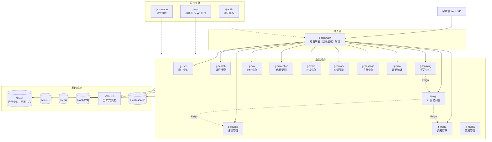
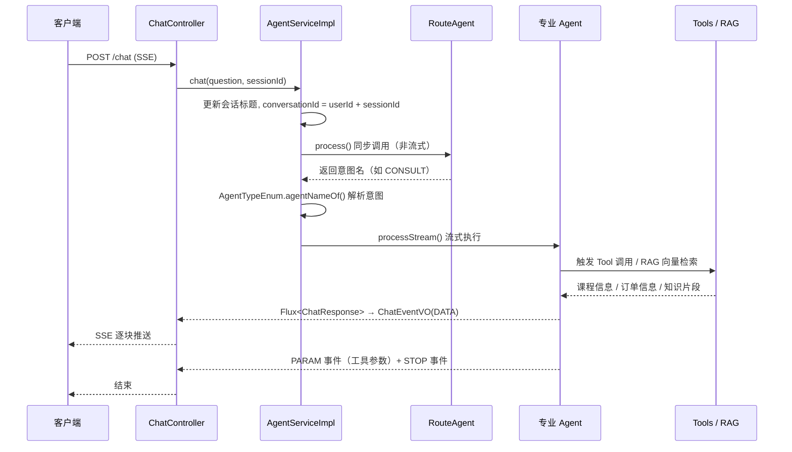

# 研途慧学

在线教育平台 · Spring Cloud 微服务架构 + Spring AI 多智能体协作


## 项目简介

本项目是一个基于 Spring Cloud 的在线教育平台，核心业务是售卖各类技能培训课程，并提供视频学习、实时问答、互动讨论等学习辅助能力。平台采用微服务架构，按业务域拆分为 17 个模块，涵盖用户、课程、搜索、学习、交易、支付、促销、考试、点赞互动、媒资、消息、数据统计与 AI 智能问答。

在此基础上，项目接入了 **Spring AI**，构建了路由工作流式的多智能体协作问答系统与语音交互能力，为平台提供 AI 驱动的多模态交互。

> 个人实践项目。其中 **AIGC 智能问答模块（多智能体协作、语音交互）** 与 **学习模块的缓存与并发优化** 是本人重点实现的模块。

## 系统架构



## 技术栈

| 分类 | 技术 |
|---|---|
| 基础框架 | Java 17、Spring Boot 3.3.5、Spring Cloud 2023.0.3、Spring Cloud Alibaba 2023.0.3.2 |
| AI 能力 | Spring AI 1.0.0、Spring AI Alibaba（DashScope）、OpenAI Whisper / TTS |
| 注册与配置 | Nacos（服务注册、配置中心、配置热更新） |
| 持久层 | MySQL 8.0.23、MyBatis-Plus 3.5.9、Elasticsearch 7.12.1 |
| 缓存与协调 | Redis、Redisson |
| 消息与调度 | RabbitMQ、XXL-Job 2.3.1 |
| 分布式事务 | Seata 1.5.1 |
| 服务调用 | OpenFeign、Spring Cloud LoadBalancer |
| 接口文档 | Knife4j 4.5.0（OpenAPI 3） |
| 云服务 | 阿里云 OSS / KMS / 短信、腾讯云 COS / VOD、支付宝、微信支付 |

## 模块说明

| 模块 | 职责 |
|---|---|
| `tj-common` | 公共组件：统一异常、响应封装、MyBatis-Plus 增强、MQ 工具、拦截器、常量 |
| `tj-api` | 服务间调用契约：Feign Client、降级 Fallback、共享 DTO |
| `tj-gateway` | 网关：路由转发、JWT 鉴权、限流、Token 传递 |
| `tj-auth` | 认证中心：登录、Token 签发与校验、权限资源 SDK |
| `tj-user` | 用户中心：学生 / 员工账号、身份与权限 |
| `tj-course` | 课程管理：课程、章节、目录、教师、课程上下架 |
| `tj-search` | 课程搜索：基于 Elasticsearch 的检索与筛选 |
| `tj-learning` | 学习中心：报名课程、视频播放进度、问答互动、积分 |
| `tj-trade` | 交易中心：下单、购物车、订单状态流转 |
| `tj-pay` | 支付中心：微信 / 支付宝支付与退款 |
| `tj-promotion` | 促销中心：优惠券发放与核销 |
| `tj-exam` | 考试中心：题目管理、考试与成绩统计 |
| `tj-remark` | 互动中心：笔记与问答的点赞、评论 |
| `tj-media` | 媒资中心：视频上传、转码、封面存储 |
| `tj-message` | 消息中心：站内信、通知、短信发送 |
| `tj-data` | 数据统计：学习数据、订单数据的聚合分析 |
| `tj-aigc` | **AI 智能问答**：多智能体协作、RAG 检索、语音识别与合成 |

## 核心技术实现

### 一、视频播放进度缓存与防抖持久化

**问题**：视频播放过程中前端会高频上报播放进度（心跳），如果每次上报都直接写库，`learning_record` 表会承受大量无意义的重复写入。

**方案**：把播放进度先落到 Redis，再用延迟队列做防抖，合并窗口内的重复上报。

- **Redis Hash 缓存**：以 `learning:record:{lessonId}` 为 key、`sectionId` 为 field 缓存播放进度 JSON，TTL 1 分钟
- **DelayQueue 延迟任务**：每次上报投递一个延迟 20 秒的任务，队列由 `CompletableFuture.runAsync` 异步消费
- **防抖比对**：任务到期时比对缓存中的 `moment` 与任务携带的值是否一致 —— 不一致说明用户还在看，说明这期间有新上报，本次任务作废；一致才真正落库
- **终止即落库**：视频播放完成时绕过延迟队列直接更新数据库，并清理缓存

效果是 20 秒窗口内的多次上报最终只落库一次，前端上报频率越高，削峰效果越明显。

**代码入口**
- 上报接口：`tj-learning/src/main/java/com/tianji/learning/controller/LearningRecordController.java`
- 业务分派：`tj-learning/.../service/impl/LearningRecordServiceImpl.java`（`addLearningRecord` / `handleVideoRecord` / `queryOldRecord`）
- 缓存与延迟核心：`tj-learning/.../utils/LearningRecordDelayTaskHandler.java`
- 延迟任务封装：`tj-learning/.../utils/DelayTask.java`（`implements Delayed`）

### 二、高并发点赞方案

**问题**：点赞是典型的写多读多场景，直接读写数据库在并发下会同时面临行锁竞争和数据一致性压力。

**方案**：读写全部走 Redis，数据库只做异步批量落库。

- **Redis Set 存点赞关系**：`likes:set:biz:{bizId}` 存点赞用户 ID，判断"是否已点赞"用 `sIsMember`，批量查询走 pipeline
- **Redis ZSet 存点赞数**：`likes:times:type:{bizType}` 以 `bizId` 为 member、点赞数为 score，做点赞数聚合
- **定时批量刷库**：`LikedTimesCheckTask` 每 20 秒用 `opsForZSet().popMin(key, 30)` 取出并移除变更记录，经 RabbitMQ 投递
- **异步落库**：消费端 `LikeTimesChangeListener` 监听 `like.record.topic` 中 `QA.times.changed` 消息，通过 `updateBatchById` 批量回写 `interaction_reply.liked_times`
- **一致性保证**：`popMin` 取出即从 ZSet 移除，保证同一条变更不会被重复消费；落库失败可由 MQ 的重试与补偿兜底

**代码入口**
- 点赞入口：`tj-remark/src/main/java/com/tianji/remark/controller/LikedRecordController.java`
- Redis 实现：`tj-remark/.../service/impl/LikedRecordServiceRedisImpl.java`
- 定时刷库：`tj-remark/.../task/LikedTimesCheckTask.java`
- MQ 消费落库：`tj-learning/.../mq/LikeTimesChangeListener.java`
- 常量定义：`tj-remark/.../constants/RedisConstants.java`、`tj-common/.../constants/MqConstants.java`

### 三、基于 Spring AI 的多智能体协作问答

**问题**：单一的通用对话无法覆盖课程咨询、推荐、购买、知识检索等差异化的业务意图，全部塞进一个 Prompt 会导致角色混乱、工具误调用。

**方案**：构建「路由工作流」多智能体架构，由路由 Agent 做意图识别，再分发到专业 Agent 执行。



**实现要点**

- **意图路由**：`RouteAgent` 的 system prompt 约束模型只输出一个意图词（`CONSULT` / `RECOMMEND` / `BUY` / `KNOWLEDGE`），`AgentServiceImpl` 用 `AgentTypeEnum.agentNameOf()` 精确匹配后，从 Spring 容器中按 `getAgentType()` 找到目标 Agent。路由调用是同步非流式的，确认意图后再开流，避免首个 token 之前的无谓流式开销
- **4 个专业 Agent**：`ConsultAgent` 课程咨询、`RecommendAgent` 课程推荐、`BuyAgent` 购买下单、`KnowledgeAgent` 知识库问答，各自持有独立的 system prompt 与工具集
- **RAG 向量检索**：`ConsultAgent` / `RecommendAgent` 挂载 `QuestionAnswerAdvisor` + **RedisVectorStore**，相似度阈值 0.6、topK 6；知识数据通过 `POST /embedding` 灌入向量库
- **Tool 远程调用**：`CourseTools` / `OrderTools` 用 `@Tool` 注解声明为模型工具，内部通过 OpenFeign 调用课程、交易微服务；通过 `toolContext` 传递 `userId` / `requestId`，并写入 `UserContext` 避免 Feign 调用丢失身份导致 401
- **会话记忆**：`MessageWindowChatMemory` 保留最近 100 条消息，`MessageChatMemoryAdvisor` 自动把历史拼入 Prompt；存储层支持 Redis（`RedisChatMemoryRepository`）与 MySQL（`JDBCChatMemoryRepository`）切换
- **流式输出与中断**：`AbstractAgent.processStream()` 把 `Flux<ChatResponse>` 映射为 `ChatEventVO`，经 SSE 推送；用 `GENERATE_STATUS` 配合 `takeWhile` 支持中途 `/chat/stop` 取消，取消时已生成内容仍会存入记忆
- **Prompt 热更新**：system prompt 托管在 Nacos，`SystemPromptTextConfig` 通过 `@PostConstruct` 拉取并 `addListener` 监听，修改 Prompt 无需重启服务

**代码入口**
- 路由分发：`tj-aigc/src/main/java/com/tianji/aigc/service/impl/AgentServiceImpl.java`
- Agent 抽象基类：`tj-aigc/.../agent/AbstractAgent.java`
- 各 Agent：`tj-aigc/.../agent/`（`RouteAgent` / `ConsultAgent` / `RecommendAgent` / `BuyAgent` / `KnowledgeAgent`）
- 工具：`tj-aigc/.../tools/CourseTools.java`、`OrderTools.java`
- 记忆：`tj-aigc/.../config/SpringAIConfig.java`、`tj-aigc/.../memory/RedisChatMemoryRepository.java`
- Prompt 热加载：`tj-aigc/.../config/SystemPromptTextConfig.java`
- 流式接口：`tj-aigc/.../controller/ChatController.java`

### 四、语音识别与合成（STT / TTS）

**方案**：基于 Spring AI 的 OpenAI 音频模型接口，实现语音与文本的双向转换。

- **TTS**：`OpenAiAudioSpeechModel.stream()` 返回 `Flux<SpeechResponse>`，通过 `ResponseBodyEmitter` 边合成边推送 mp3 音频块，前端可流式播放，无需等待整段合成完成
- **STT**：`OpenAiAudioTranscriptionModel.call()` 接收上传的音频文件，返回识别文本，再用 opencc4j 做繁体转简体
- **异步非阻塞**：音频推送基于响应式流，不占用请求线程

**代码入口**
- `tj-aigc/.../controller/AudioController.java`（`POST /audio/stt`、`POST /audio/tts-stream`）
- `tj-aigc/.../service/impl/AudioServiceImpl.java`

## 快速开始

### 环境依赖

| 组件 | 版本 / 说明 |
|---|---|
| JDK | 17+ |
| Maven | 3.8+ |
| MySQL | 8.0 |
| Redis | 7.x |
| RabbitMQ | 3.x |
| Nacos | 2.x（注册中心 + 配置中心） |
| XXL-Job | 2.3.1（可选，部分定时任务） |
| Elasticsearch | 7.12.1（可选，课程搜索模块） |

### 配置说明

各服务的**数据库连接、Redis、RabbitMQ、Nacos 地址等配置位于 Nacos 配置中心**，通过 `shared-*.yaml` 共享配置下发，仓库中仅保留本地引导配置（`application-local.yml`）。

AI 模块的 **system prompt 同样托管在 Nacos**（`route-agent-system-message.txt` 等），仓库中不包含这些文件，需要在 Nacos 中自行创建：

```
tj.ai.prompt.system.chat            -> system-chat-message.txt
tj.ai.prompt.system.route-agent     -> route-agent-system-message.txt
tj.ai.prompt.system.consult-agent   -> consult-agent-system-message.txt
tj.ai.prompt.system.recommend-agent -> recommend-agent-system-message.txt
tj.ai.prompt.system.buy-agent       -> buy-agent-system-message.txt
tj.ai.prompt.system.knowledge-agent -> knowledge-agent-system-message.txt
```

大模型与语音模型的 API Key 通过环境变量或 Nacos 配置注入（`spring.ai.openai.*`、DashScope 相关配置），**不要提交到仓库**。

### 启动

```bash
# 依次启动（需先确保 Nacos / MySQL / Redis / RabbitMQ 就绪）
mvn clean install -DskipTests

java -jar tj-gateway/target/tj-gateway.jar
java -jar tj-auth/tj-auth-service/target/tj-auth-service.jar
java -jar tj-course/target/tj-course.jar
# ... 其余服务按需启动
java -jar tj-aigc/target/tj-aigc.jar
```

接口文档由 Knife4j 提供，各服务启动后访问 `http://localhost:{port}/doc.html`。

## 接口示例

### 多智能体问答（SSE 流式）

```bash
curl -N -X POST http://localhost:8096/chat \
  -H "Content-Type: application/json" \
  -d '{"question":"我想学 Java，有什么推荐课程？","sessionId":"s-001"}'
```

返回为 SSE 事件流，`eventType` 含义：`1001` 流式文本、`1003` 工具参数（课程 / 订单卡片数据）、`1002` 流结束。

### 语音识别

```bash
curl -X POST http://localhost:8096/audio/stt \
  -F "audioFile=@question.mp3"
```

### 语音合成（流式返回 mp3）

```bash
curl -X POST http://localhost:8096/audio/tts-stream \
  -H "Content-Type: text/plain" \
  -d "欢迎来到研途慧学" --output speech.mp3
```

### 知识库灌入

```bash
curl -X POST http://localhost:8096/embedding \
  -H "Content-Type: application/json" \
  -d '["Java 课程介绍文本片段一", "Java 课程介绍文本片段二"]'
```

## 目录结构

```
研途慧学
├── tj-common/          公共组件
├── tj-api/             服务间 Feign 契约与共享 DTO
├── tj-gateway/         网关
├── tj-auth/            认证中心
├── tj-user/            用户中心
├── tj-course/          课程管理
├── tj-search/          课程搜索
├── tj-learning/        学习中心
├── tj-trade/           交易中心
├── tj-pay/             支付中心
├── tj-promotion/       促销中心
├── tj-exam/            考试中心
├── tj-remark/          点赞互动
├── tj-media/           媒资管理
├── tj-message/         消息中心
├── tj-data/            数据统计
├── tj-aigc/            AI 智能问答
├── Dockerfile
└── startup.sh
```

## 安全说明

仓库中**不包含任何真实凭证**。支付商户密钥、云服务 AccessKey、大模型 API Key 等均以占位符形式声明，需通过环境变量或配置中心注入：

```yaml
ali:
  merchantPrivateKey: ${tj.pay.ali.merchant-private-key:}
wx:
  privateKey: ${tj.pay.wx.private-key:}
```

`application-local.yml` 中的 `nacos` / Redis 密码等为本地开发默认值，指向内网地址，请勿用于生产环境。
